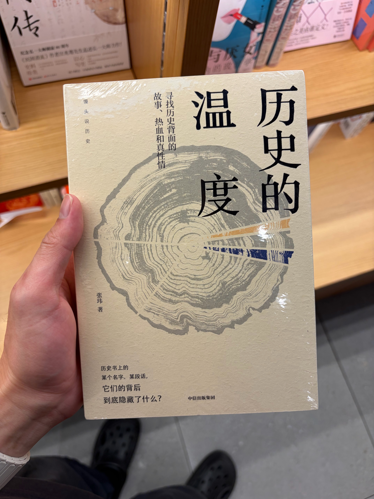
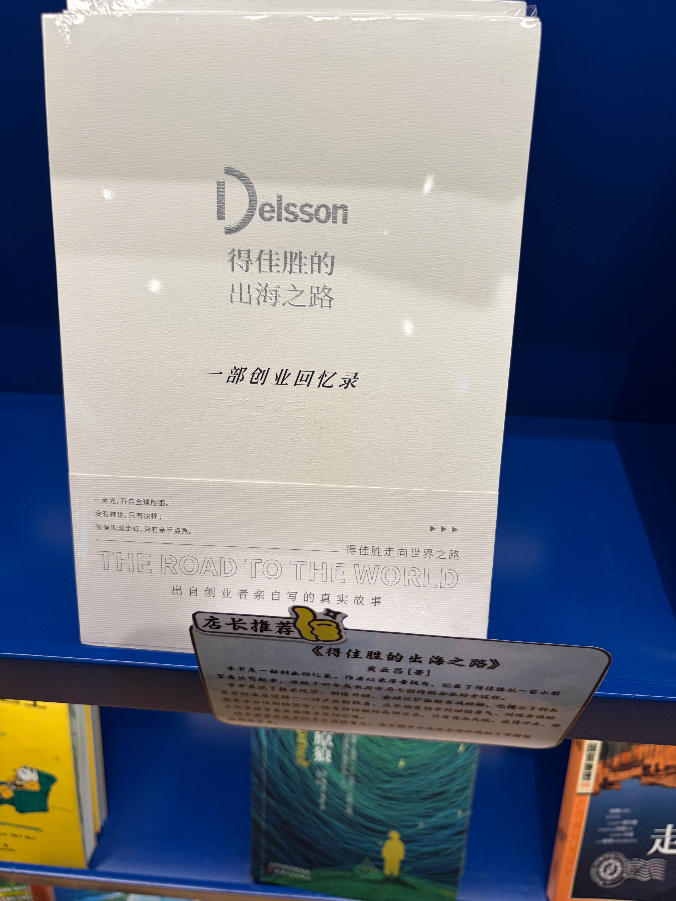
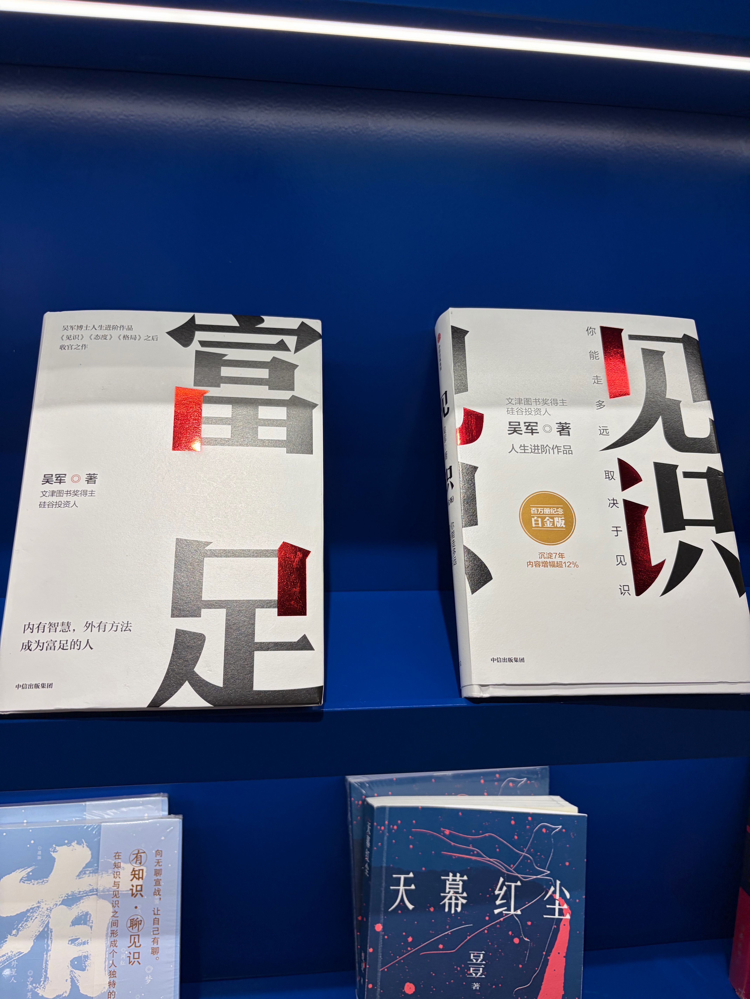
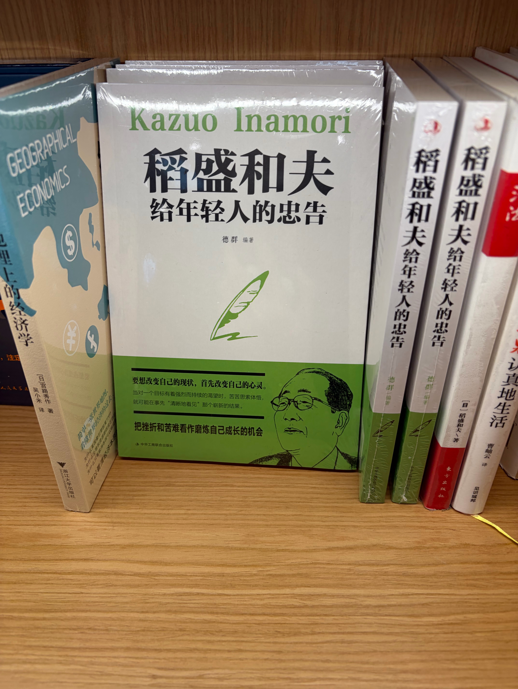

# Explore list

去哪里玩、可以学习探索什么、稍后读的合集。条目用 GitHub 待办勾选（`- [ ]` / `- [x]`），不是有序列表。看完或弃掉就勾掉或删除；用 git 保留版本历史。

从提醒事项稍后读整理 · 迁入 GitHub · 2026-11-02

## 文章 / 链接

- [ ] [分享一份给产品团队的9条实战团队公约](https://mp.weixin.qq.com/s/bT_ulhdsCXby6erFk6fFMA)
- [ ] [浙江现货市场：竞价空间组成要素解析](https://mp.weixin.qq.com/s/BvfH8PdC_u0EKLjT12q96A)（原 Work）
- [ ] [“电算师”面世！新一代售电经营决策系统，让每一度电的经营更聪明](https://mp.weixin.qq.com/s/qnRybmrhsT_eCj8nSVhiJg)（原 Work）
- [ ] [scripod 总结](https://scripod.com/episode/6wxbr39i9c93mgd420tevmel)
- [ ] qa.agent 招聘/状态页（含 token，勿外传） — 见私密笔记，勿提交明文 token 到公开处
- [ ] 分享一份给产品团队的9条实战团队公约（原 Cache）
- [ ] 团队公约点评摘录（原 Cache）：这篇解决的痛点很实在：团队价值观太虚落不了地，工作计划又太硬没有共识感，公约刚好卡在中间那个甜蜜点。9条里含金量最高的是第1条「准确定义问题」……「我要批量退款」背后其实是「某批次质量问题导致集中退款」……

## 播客

- [ ] [E43.产品 | 求职经验谈：写简历的“关键词”思维 & 面试答“成长”比成功更重要](https://www.xiaoyuzhoufm.com/episode/61589826ae1d32c4f86c1933)
- [ ] [05上桌聊 | 打工秘籍上：写对了简历，每天都是金三银四](https://www.xiaoyuzhoufm.com/episode/628ed8046c7eec4d0113c99e)
- [ ] [19.如何写好简历](https://www.xiaoyuzhoufm.com/episode/65e3cc4d2e0f97da8d0d786d)
- [ ] [EP125 12 个问题，搞懂 Vibe Coding 爆火真相](https://xyzfm.link/s/QOolmx) — 标记 1:02:51；嘉宾后面分享的内容/社区/播客
- [ ] 韦青 · 无人知晓播客整理
- [ ] [灵感电波 · 一切都很流畅](https://www.linggandianbo.com/newsletter-119/)
- [ ] 灵感电波 · 年度十佳文章

## 阅读 / 笔记

- [ ] [Elon Musk: 文明的不同等级](https://www.youtube.com/watch?v=JRDR7XtQT5U&t=8s)
- [ ] hackernews 最佳十个博客
- [ ] tw93 大模型博客
- [ ] 书记阅读：skin in the game
- [ ] 交大生存手册 pdf to markdown
- [ ] 张一鸣微博整理与应用
- [ ] 置身钉内
- [ ] 设计书籍
- [ ] kindle 上 instapaper 的格式（原文拼写 instapeper）
- [ ] 《历史的温度》· 张玮（馒头说历史）— 贵阳机场看到 · [照片](photos/guiyang-airport/历史的温度.jpg)
- [ ] 《得佳胜的出海之路》· 黄云昌（Delsson 创业回忆录）— 贵阳机场看到 · [照片](photos/guiyang-airport/得佳胜的出海之路.jpg)
- [ ] 《富足》· 吴军 — 贵阳机场看到 · [照片](photos/guiyang-airport/吴军_富足_见识.jpg)
- [ ] 《见识》· 吴军（百万册纪念白金版）— 贵阳机场看到 · 同照见上
- [ ] 《稻盛和夫给年轻人的忠告》· 德群 — 贵阳机场看到 · [照片](photos/guiyang-airport/稻盛和夫给年轻人的忠告.jpg)
- [ ] 《怪诞行为学》· 丹·艾瑞里（可预测的非理性）— 贵阳机场看到 · [照片](photos/guiyang-airport/怪诞行为学.jpg)

<!-- 贵阳机场书架照片 -->

## 去哪玩 / ShangHai

- [x] wtcc（原 ShangHai 列表）· WTCC 2026 已于 10/22–25 结束

## 其他

- [ ] 求职简历相关（原个人列表）
- [ ] UI 设计收集
- [ ] [Apple Human Interface Guidelines](https://developer.apple.com/design/human-interface-guidelines/) — 人机交互 / 设计指南
- [ ] [Material Design 3](https://m3.material.io/) — Google 人机交互 / 设计系统指南
